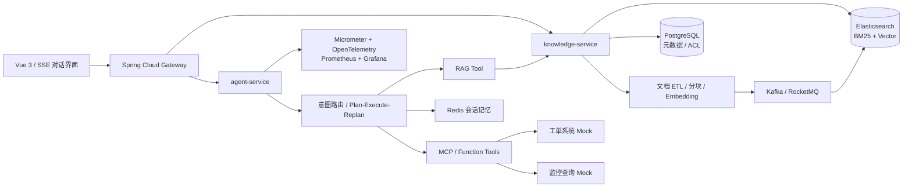

# OpsMind：企业知识与工单处置 Agent 平台

> 一个面向企业内部 IT 支持、研发运维和制度问答场景的生产级 RAG Agent。它不仅回答“怎么做”，还会根据权限查询工单、检索历史故障、生成处置计划，并在人工确认后调用工具执行低风险操作。

## 当前实现状态

当前完成 **第 8 步：可复现 Embedding 与向量检索基线（FEAT-008）**。

- Java 21 + Spring Boot 4.1.1，使用项目内置 Maven Wrapper，不依赖本机 Maven。
- 已引入 Web MVC、Validation、Actuator，并通过 Spring AI 2.0.1 BOM 锁定后续 AI 依赖版本。
- 已实现统一 API 响应结构和 `GET /api/v1/system/info` 系统信息接口。
- 已实现 PDF、DOCX、Markdown、TXT、HTML 上传，包含 20 MB 限制、文件签名检查和安全文件名处理。
- 使用 SHA-256 内容寻址，同一内容只保存一份，并返回原文档及原处理任务。
- 已使用 PostgreSQL 持久化文档与入库任务元数据，通过数据库唯一约束保证跨重启、跨实例内容去重。
- 已使用 Apache Tika 3.3.2 解析 PDF、DOCX、HTML、Markdown 和 TXT，清理控制字符、换行与冗余空白。
- 已通过 Flyway V2 持久化解析正文、标题、检测媒体类型、字符数和解析时间；原始文件保存在 `data/documents`。
- 解析任务支持条件抢占、失败信息记录、失败重试和 5 分钟超时租约回收。
- 已提供文档分页列表，单次 JOIN 返回文档与任务状态，默认每页 20 条、最大 100 条，按创建时间倒序。
- 已实现标题感知的 Parent-Child 分块：父块保留完整上下文，子块用于后续精确召回，并持久化标题路径、内容哈希和预估 Token 数。
- 分块采用确定性 ID 和事务化全量替换，同一正文重复重建不会产生重复记录或改变 Chunk ID。
- 已提供可替换的 `EmbeddingProvider`，默认使用离线可运行的 256 维中文字符 n-gram 特征哈希，模型名和维度随向量一同持久化。
- 已实现 Child 精确余弦检索和 Parent 上下文展开，可按单文档过滤并返回候选数、相似度、标题路径与父块正文。
- 已集成 Swagger UI，可在浏览器中查看接口模型、选择文件并直接发起调试请求。
- 已配置健康检查、优雅停机和基础管理端点。
- 当前自动化测试：34 个，全部通过。

本地验证：

```powershell
docker compose -p opsmind up -d postgres
.\mvnw.cmd test
.\mvnw.cmd spring-boot:run
```

项目自带的 PostgreSQL 默认映射到宿主机 `5433`，避免与本机常见的 `5432` 实例冲突。应用默认连接 `jdbc:postgresql://localhost:5433/opsmind`；也可使用 `DB_URL`、`DB_USERNAME`、`DB_PASSWORD` 覆盖连接配置。

数据库物理文件通过绑定挂载保存在项目的 `data/postgres`，备份文件保存在 `data/backups`，两者均被 Git 忽略。物理文件是 PostgreSQL 内部格式，不应手工编辑；查看表数据可执行：

```powershell
docker exec -it opsmind-postgres-1 psql -U opsmind -d opsmind
```

启动后访问：

- 业务探针：`http://localhost:8080/api/v1/system/info`
- 健康检查：`http://localhost:8080/actuator/health`
- 文档上传：`POST http://localhost:8080/api/v1/documents`
- 文档列表：`GET http://localhost:8080/api/v1/documents?page=0&size=20`
- 文档状态：`GET http://localhost:8080/api/v1/documents/{documentId}`
- 触发解析：`POST http://localhost:8080/api/v1/documents/{documentId}/process`
- 查看正文：`GET http://localhost:8080/api/v1/documents/{documentId}/content`
- 重建分块：`POST http://localhost:8080/api/v1/documents/{documentId}/chunks/rebuild`
- 查询分块：`GET http://localhost:8080/api/v1/documents/{documentId}/chunks?type=CHILD&page=0&size=50`
- 重建向量：`POST http://localhost:8080/api/v1/documents/{documentId}/embeddings/rebuild`
- 向量检索：`POST http://localhost:8080/api/v1/search`
- Swagger UI：`http://localhost:8080/swagger-ui/index.html`
- OpenAPI JSON：`http://localhost:8080/v3/api-docs`

上传示例：

```powershell
curl.exe -F "file=@README.md" http://localhost:8080/api/v1/documents
```

上传响应中的 `documentId` 用于触发解析、分块、向量化和限定检索范围。在 Swagger UI 中可按“上传 → 触发解析 → 重建分块 → 重建向量 → 向量检索”的顺序完成调试。

Swagger UI 默认在本地启用，生产环境可设置 `SWAGGER_ENABLED=false` 关闭 UI 和 API 文档。

当前限制：默认 `local-feature-hashing-v1` 是为了离线开发和回归测试设计的确定性特征向量，只能建立词面相关性基线，不能替代训练过的语义 Embedding 模型；检索会把当前模型的全部候选向量读入 JVM 做精确余弦计算，数据量增大后不具备扩展性。下一步 `FEAT-009` 将接入真实 OpenAI 兼容 Embedding 适配器与 pgvector，在数据库侧完成 Top-K 向量召回，并保留本地模型用于测试降级。

## 1. 为什么这个项目适合 Agent 开发工程师简历

普通“上传 PDF 后问答”只能证明调用过大模型 API。本项目覆盖岗位更关注的五类能力：

1. **RAG 全链路**：解析、清洗、分块、Embedding、混合检索、重排、引用和评测。
2. **Agent 工程化**：意图路由、任务规划、Tool Calling、短期记忆、失败重试和人工审批。
3. **Java 后端能力**：Spring Boot、异步任务、缓存、消息队列、幂等、限流和多租户权限。
4. **生产治理**：Prompt Injection 防护、工具分级、审计日志、Token 预算和模型降级。
5. **可量化优化**：Recall@K、MRR、Faithfulness、P95 延迟、Token 成本和工具成功率。

项目定位应写成“个人独立完成的生产级原型”，不要虚构真实企业用户量。性能和准确率只有在完成压测、评测后才能写成最终数字。

## 2. 典型业务场景

用户提问：

> 线上支付服务频繁出现数据库连接池耗尽，请结合内部规范和最近相似事故分析原因，给出处理方案，并帮我创建 P2 工单。

系统执行：

1. `IntentRouter` 判断这是“知识检索 + 故障分析 + 工单操作”。
2. `QueryRewrite` 将口语问题拆成故障现象、服务名、时间范围和检索查询。
3. 从故障手册、架构文档、历史工单中执行 BM25 + 向量混合检索。
4. 使用 Reranker 对候选片段重排，并进行文档权限过滤。
5. Agent 调用 `queryMetrics`、`searchIncidents` 等只读工具补齐实时上下文。
6. 模型输出带来源引用的根因假设、排查顺序和风险说明。
7. 调用 `createTicket` 前进入 Human-in-the-loop 审批；用户确认后执行并写入审计日志。

## 3. 总体架构



初版建议做成 **模块化单体**，保留清晰模块边界；第二阶段再拆 `agent-service`、`knowledge-service` 和 `ingestion-worker`。这样既能展示微服务设计，又避免个人项目一开始就陷入部署复杂度。

## 4. 技术栈

| 层次 | 推荐方案 | 作用 |
|---|---|---|
| 核心框架 | Java 21、Spring Boot 4.1、Spring AI 2.0 | Agent、模型调用、Advisor、RAG |
| API | Spring WebFlux、SSE、Spring Security | 流式响应、认证鉴权 |
| 数据 | PostgreSQL、Spring JDBC、Flyway | 用户、租户、文档元数据、任务状态 |
| 检索 | Elasticsearch | BM25、向量检索、RRF 融合、过滤 |
| 缓存/记忆 | Redis | 会话记忆、语义缓存、分布式锁、限流 |
| 异步链路 | Kafka 或 RocketMQ（二选一） | 文档解析、Embedding、索引更新、失败重试 |
| 文档解析 | Apache Tika、PDFBox | PDF、DOCX、Markdown、HTML 抽取 |
| 模型 | OpenAI 兼容接口 / 通义千问 / DeepSeek，可配置切换 | Chat、Embedding、Rerank |
| 可观测性 | Micrometer、OpenTelemetry、Prometheus、Grafana | Trace、Token、延迟、错误率、工具调用 |
| 工程化 | Docker Compose、Testcontainers、GitHub Actions | 本地一键运行、集成测试、CI |

不要同时堆 LangChain4j 和 Spring AI。主项目使用 Spring AI，面试时能解释框架抽象和自行实现的部分即可。

## 5. 模块划分

```text
opsmind/
├─ opsmind-bootstrap          # 启动与配置
├─ opsmind-agent              # Agent 状态机、规划、工具调用、记忆
├─ opsmind-rag                # 查询改写、召回、融合、重排、上下文构建
├─ opsmind-knowledge          # 文档、版本、分块、索引、ACL
├─ opsmind-tools              # 工单、监控、CMDB 等工具及 MCP 适配
├─ opsmind-evaluation         # 离线评测集、指标、回归测试
├─ opsmind-observability      # Trace、指标、审计、成本统计
├─ opsmind-common             # 错误码、DTO、公共安全组件
└─ deploy                     # Docker Compose、Grafana Dashboard
```

关键接口：

- `POST /api/v1/chat/stream`：SSE 流式对话，返回回答、引用和 Agent 步骤事件。
- `POST /api/v1/documents`：上传文档并异步建立索引。
- `GET /api/v1/tasks/{id}`：查看文档处理或 Agent 任务状态。
- `POST /api/v1/approvals/{id}`：批准或拒绝高风险工具调用。
- `POST /api/v1/evaluations/run`：执行固定评测集并生成报告。

## 6. RAG 核心链路

### 6.1 离线入库

`上传 -> SHA-256 去重 -> Tika 解析 -> 标题/表格感知分块 -> 元数据增强 -> Embedding -> 批量写入索引 -> 版本切换`

建议实现：

- 分块采用 `父文档 1200~1600 tokens + 子块 300~500 tokens + 10% overlap`。
- 子块用于召回，父块用于生成，降低碎片化上下文。
- 元数据至少包含 `tenantId、departmentId、documentId、version、page、headingPath、securityLevel`。
- 通过 `documentId + version + chunkHash` 保证重复消费幂等。
- 新版本索引完成后再原子切换，避免更新期间查到半份文档。
- 消费失败进入重试队列和死信队列，可在管理端重新投递。

### 6.2 在线检索

`问题规范化 -> 多路查询改写 -> ACL 过滤 -> BM25/Vector 并行召回 -> RRF -> Cross-Encoder 重排 -> 去重 -> 上下文压缩 -> 生成`

推荐参数从以下基线开始，再通过评测集调整：

- BM25 Top 30 + Vector Top 30。
- RRF 融合后保留 Top 20。
- Reranker 重排后取 Top 5~8。
- Context Token Budget 控制在模型上下文的 30%~40%。
- 无足够证据时明确回答“不确定”，不允许使用模型记忆补造内部事实。
- 每个结论返回 `documentId、标题、页码、chunkId`，前端可定位原文。

### 6.3 检索增强点

- **Query Rewrite**：消歧、补全缩写、结合会话上下文生成独立查询。
- **Multi-Query**：对复杂问题生成 2~3 个检索子查询，再去重融合。
- **Metadata Filter**：先进行租户与部门权限过滤，避免“召回后再遮挡”的越权风险。
- **Parent-Child Retrieval**：小块匹配、大块供模型阅读。
- **Semantic Cache**：仅缓存无用户敏感上下文、相似度足够高且知识版本一致的查询。

## 7. Agent 设计

不要为了“多 Agent”而堆多个角色。用一个 Supervisor 管理确定性的状态机，模型只负责它擅长的判断。

状态流：

```text
RECEIVED
  -> CLASSIFY
  -> PLAN
  -> RETRIEVE / CALL_READ_TOOL
  -> REFLECT（证据是否足够）
  -> RESPOND
  -> WAIT_APPROVAL（仅写操作）
  -> CALL_WRITE_TOOL
  -> FINISHED / FAILED
```

核心机制：

- `Planner` 输出结构化 JSON，而不是自由文本，使用 Bean Validation 校验。
- Agent 最大循环 6 次，并设置 Token、耗时和工具调用次数预算，防止死循环。
- 读工具可自动执行；写工具必须审批；高危工具默认禁用。
- 工具参数由服务端做二次鉴权与校验，不能信任模型生成的参数。
- 每次状态迁移持久化 `agent_run` 和 `agent_step`，支持失败恢复与完整审计。
- 工具调用使用 `requestId` 做幂等，超时采用指数退避；不可重试的业务异常直接交回 Planner。
- 通过 MCP 暴露“搜索知识库”和“查询工单”能力，同时保留普通 Function Calling 版本做对比。

首期工具：

| 工具 | 风险级别 | 行为 |
|---|---:|---|
| `searchKnowledge` | L0 | 搜索有权限的知识库 |
| `searchIncidents` | L0 | 查询历史事故与工单 |
| `queryMetrics` | L0 | 查询模拟监控指标 |
| `createTicketDraft` | L1 | 生成工单草稿，不落库 |
| `createTicket` | L2 | 审批后创建工单 |
| `updateTicket` | L2 | 审批后更新状态或备注 |

## 8. 安全与稳定性

- **Prompt Injection**：外部文档一律视为不可信数据，系统提示明确禁止执行文档中的指令；对检索内容做指令特征检测和来源标记。
- **最小权限**：在检索 SQL/ES Query 层强制注入租户与 ACL 条件；工具使用用户身份执行二次授权。
- **敏感信息**：入库和日志链路做手机号、邮箱、密钥等脱敏；默认不记录完整 Prompt、工具参数和结果。
- **模型降级**：主模型超时后切备用模型；模型全部不可用时仍提供纯检索结果。
- **限流熔断**：按租户和用户限流，模型/Embedding/Rerank 调用使用 Resilience4j 隔离、超时和熔断。
- **成本治理**：记录每次请求输入/输出 Token、模型、缓存命中和估算成本，设置租户日预算。

## 9. 评测与验收指标

建立 150~300 条“小而可信”的人工标注集，包含事实问答、跨文档问题、无答案问题、权限隔离问题和工具调用问题。每次修改分块策略、Prompt 或模型后自动回归。

| 维度 | 指标 | 建议目标（完成实测后再写进简历） |
|---|---|---:|
| 召回 | Recall@5 | >= 0.85 |
| 排序 | MRR@10 / NDCG@10 | >= 0.75 |
| 回答 | Faithfulness | >= 0.90 |
| 拒答 | 无答案识别 F1 | >= 0.85 |
| Agent | 工具选择准确率 | >= 0.90 |
| Agent | 任务完成率 | >= 0.85 |
| 性能 | 首 Token P95 | <= 2.0 s（不含冷启动） |
| 性能 | 检索链路 P95 | <= 500 ms |
| 稳定性 | 文档任务成功率 | >= 99% |

必须保留三组对照实验：

1. 向量检索 vs BM25 vs 混合检索。
2. 固定切块 vs 标题感知 + Parent-Child 切块。
3. 无重排 vs Reranker。

评测报告要展示质量、延迟和成本三者的取舍，而不是只报一个“准确率”。

## 10. 面试时最值得讲的技术难点

### 难点一：混合检索不是简单相加

BM25 与向量相似度不在同一量纲，直接加权容易失真。先用 RRF 按名次融合，再用 Reranker 精排；通过离线评测验证混合检索对专有名词和语义改写问题的改善。

### 难点二：过滤条件会影响向量召回

多租户和 ACL 过滤可能使 ANN 候选不足。可提高候选池、按租户分索引/分区，并监控“过滤后有效候选数”。数据量小时优先用精确检索建立质量基线。

### 难点三：Agent 的不确定性与业务确定性冲突

用有限状态机约束流程、结构化输出约束计划、工具服务端校验约束执行；写操作增加审批点和幂等键，使模型“提出动作”，业务系统“决定是否执行”。

### 难点四：效果退化难定位

为每次请求记录 Query Rewrite、召回列表、融合得分、重排结果、引用片段、模型版本和 Prompt 版本，通过 Trace 将整条链路串联；使用固定数据集做版本回归。

## 11. 六周实现计划

### 第 1 周：最小闭环

- Spring Boot 工程、登录鉴权、文档上传、Tika 解析。
- Elasticsearch 向量检索、基础问答、SSE 流式输出和引用。

### 第 2 周：检索质量

- 标题感知与 Parent-Child 分块。
- BM25 + Vector + RRF + Reranker。
- 建立首版评测集和检索指标脚本。

### 第 3 周：Agent 与工具

- 实现状态机、Planner、Tool Calling、会话记忆。
- 完成工单、监控和历史事故三个 Mock Tool。

### 第 4 周：工程化

- Kafka/RocketMQ 异步入库、幂等、重试和死信队列。
- Redis 缓存、限流、多租户 ACL、Human-in-the-loop。

### 第 5 周：可观测与评测

- OpenTelemetry Trace、Prometheus 指标和 Grafana 看板。
- RAG 回归评测、Agent 轨迹评测、成本统计。

### 第 6 周：作品集包装

- Docker Compose 一键启动、Testcontainers 集成测试和 CI。
- 架构图、演示视频、评测报告、接口文档和故障复盘文章。

## 12. 简历写法

项目名建议：

**OpsMind——基于 Spring Boot/Spring AI 的企业知识与工单处置 Agent 平台**

项目描述：

> 面向企业 IT 支持与研发运维场景，构建集知识问答、故障分析和工单协同于一体的 RAG Agent；支持多租户知识库、混合检索、工具调用、人工审批、全链路评测与可观测性。

完成项目并取得真实数据后，可按下面方式写 4 条经历：

- 基于 **Spring Boot 3 + Spring AI** 设计 Plan-Execute-Reflect Agent，以有限状态机约束工具调用流程，实现知识检索、监控查询及工单创建等工具编排，并通过审批门禁、幂等键与服务端鉴权保障写操作安全。
- 搭建 PDF/DOCX/Markdown 文档 ETL 链路，采用标题感知、Parent-Child 分块及增量索引；实现 **BM25 + Dense Vector + RRF + Reranker** 多阶段检索，使 Recall@5 从 `[基线]` 提升至 `[实测值]`。
- 构建包含事实、跨文档、无答案和越权问题的 `[N]` 条评测集，引入 Recall@K、MRR、Faithfulness、拒答 F1 和工具选择准确率，形成 Prompt/模型/检索策略自动回归机制。
- 使用 Redis、消息队列和 Resilience4j 完成语义缓存、异步索引、失败重试、限流熔断与模型降级；基于 OpenTelemetry + Prometheus + Grafana 监控 Token 成本、首 Token 延迟和 Agent 工具成功率。

数字一定替换为自己压测和评测得到的结果。面试官追问时，应能展示评测集、Grafana 截图、Trace 和一段失败案例复盘。

## 13. MVP 完成标准

- 可上传至少三类文档并展示处理进度。
- 回答包含可点击引用，且能定位到原文页码或章节。
- 可对同一问题比较 BM25、Vector 和 Hybrid 三种结果。
- Agent 能查询知识和监控数据，并在确认后创建工单。
- 越权文档无法被召回，恶意文档指令不会触发工具。
- 有不少于 100 条自动评测数据、一次对照实验报告和一份压测报告。
- `docker compose up` 能启动完整演示环境。

## 14. 开发与变更记录

本项目采用“需求/问题 → 修改 → 验证 → 效果”的闭环记录方式。后续每次功能实现、缺陷修复、性能优化、架构调整和配置变更，都必须同步更新 [CHANGELOG.md](CHANGELOG.md)。

记录规则：

- 每项变更分配唯一编号，例如 `FEAT-001`、`FIX-001`、`PERF-001`、`ARCH-001`。
- 写清要解决的问题及其证据，避免只记录“优化代码”一类模糊描述。
- 列出核心修改和受影响文件，便于代码审查与问题定位。
- 记录测试、评测或压测命令及结果；未验证的效果必须标记为“待验证”。
- 性能和质量优化必须保留修改前后的同口径指标，注明数据集、环境和样本量。
- 高风险改动必须说明兼容性、潜在风险和回滚方案。
- Git 提交信息携带变更编号，例如 `feat(rag): FEAT-003 增加混合检索`。

完整填写规范及模板见 [docs/CHANGE_RECORD_GUIDE.md](docs/CHANGE_RECORD_GUIDE.md)。

